<div align="center">

# WebGIS Indeks Spektral Kabupaten & Kota Madiun

**Dashboard WebGIS interaktif untuk visualisasi indeks spektral Sentinel-2 dan
statistik zonal per kecamatan di Kabupaten & Kota Madiun.**


<br>

<a href="docs/01_peta_ndvi.png">Peta</a> ·
<a href="docs/09_peta_ndvi_kelas.png">Peta Kelas</a> ·
<a href="docs/05_popup_kecamatan.png">Popup</a> ·
<a href="docs/06_tab_statistik.png">Statistik Zonal</a> ·
<a href="docs/08_tampilan_ponsel.png">Ponsel</a> ·
<a href="#-memulai">Menjalankan</a> ·
<a href="#keterangan">Keterangan</a>

</div>

---

Madiun terdiri atas Kabupaten Madiun dan Kota Madiun dengan karakter wilayah yang
beragam: kawasan hunian padat, lahan pertanian, hingga badan air. Dashboard ini
merangkum karakter tersebut menjadi **empat indeks spektral** yang dapat
dijelajahi langsung di peta, dilengkapi **statistik zonal per kecamatan** untuk
membandingkan wilayah secara objektif.

Hasil olahan indeks menampilkan pola tutupan lahan: NDVI untuk vegetasi, NDBI
untuk kawasan terbangun, NDWI untuk badan air, dan NDCI untuk menandai awan.

## Daftar Isi

- [Tangkapan Layar](#-tangkapan-layar)
- [Fitur](#-fitur)
- [Indeks Spektral](#-indeks-spektral)
- [Keterangan](#keterangan)
- [Struktur Proyek](#-struktur-proyek)
- [Memulai](#-memulai)
- [Sumber Data](#-sumber-data)
- [Keluaran](#-keluaran)
- [Catatan](#-catatan)
- [Penulis](#-penulis)

## Tangkapan Layar

Tab **Peta Interaktif** menampilkan empat indeks spektral yang dapat dinyalakan
satu per satu, masing-masing dengan palet warnanya sendiri.

| NDVI — vegetasi | NDBI — lahan terbangun |
|:---:|:---:|
| 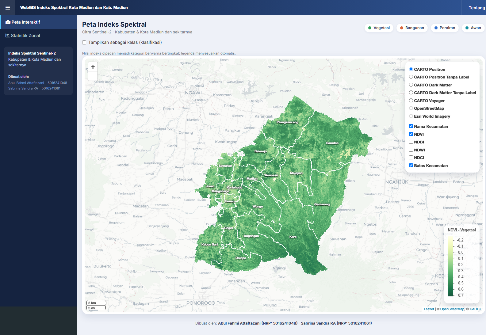 | 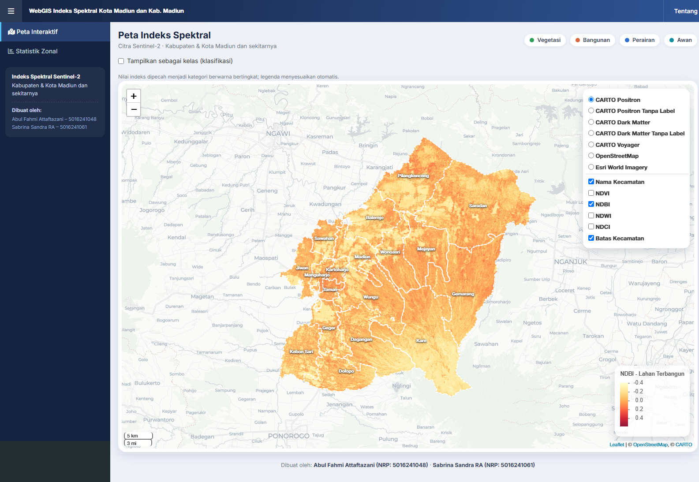 |

| NDWI — perairan | NDCI — awan |
|:---:|:---:|
| 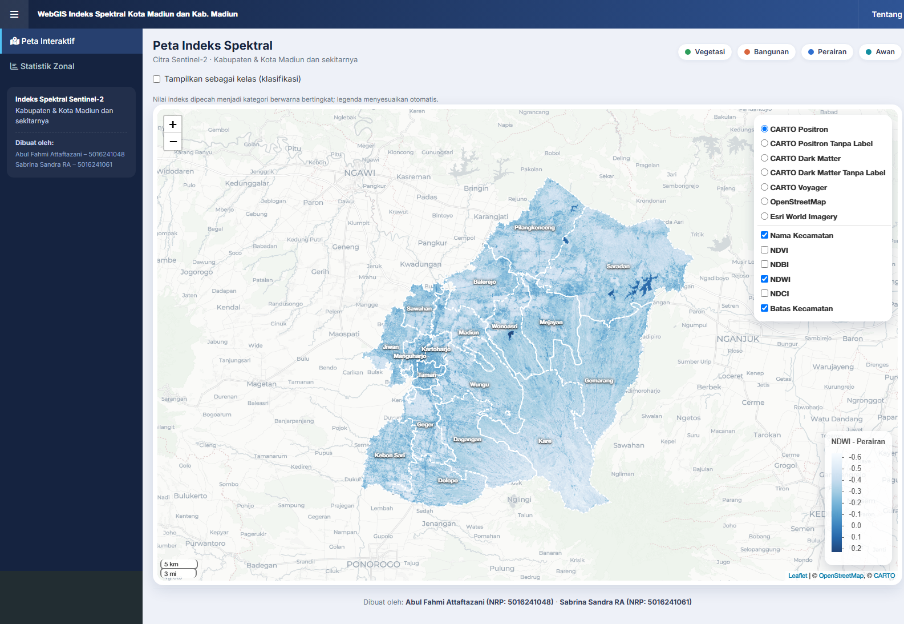 | 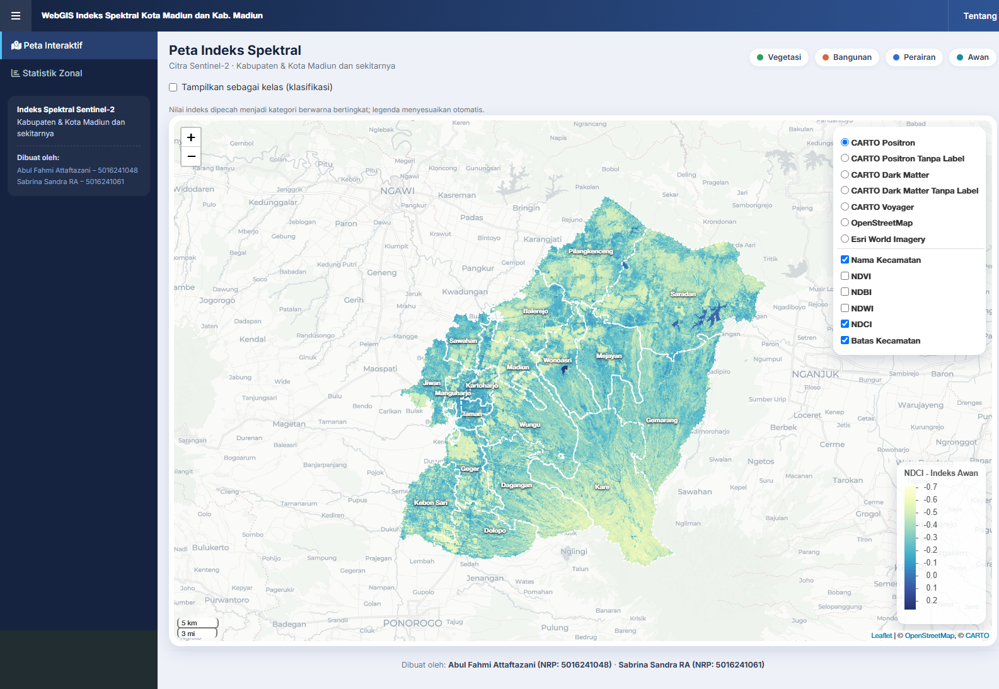 |

Selain gradasi kontinu, setiap indeks dapat ditampilkan sebagai **klasifikasi
empat kelas** melalui layer berakhiran "Kelas" pada panel layer (mis.
`NDVI Kelas`). Tampilan kontinu dan kelas untuk indeks yang sama saling
eksklusif: menyalakan salah satu otomatis mematikan yang lain, dan legenda
menyesuaikan sendiri.

| NDVI Kelas — kerapatan vegetasi | NDBI Kelas — kepadatan terbangun |
|:---:|:---:|
| 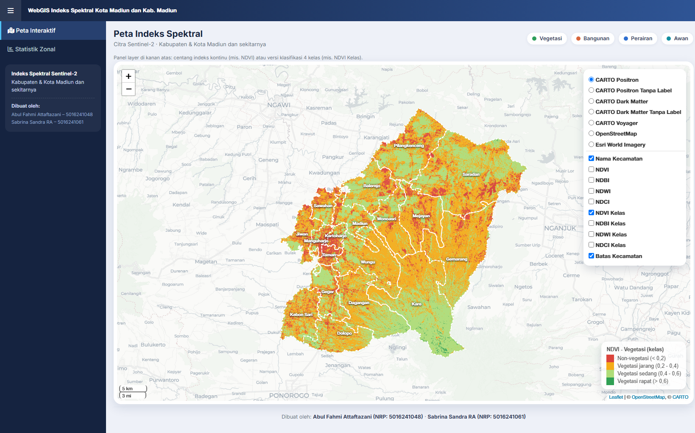 | 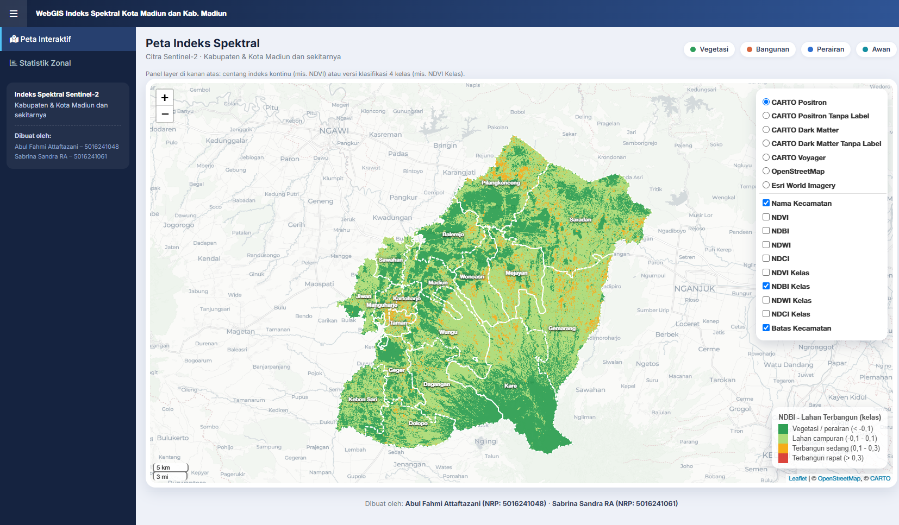 |

| NDWI Kelas — kebasahan permukaan | NDCI Kelas — tutupan awan |
|:---:|:---:|
| 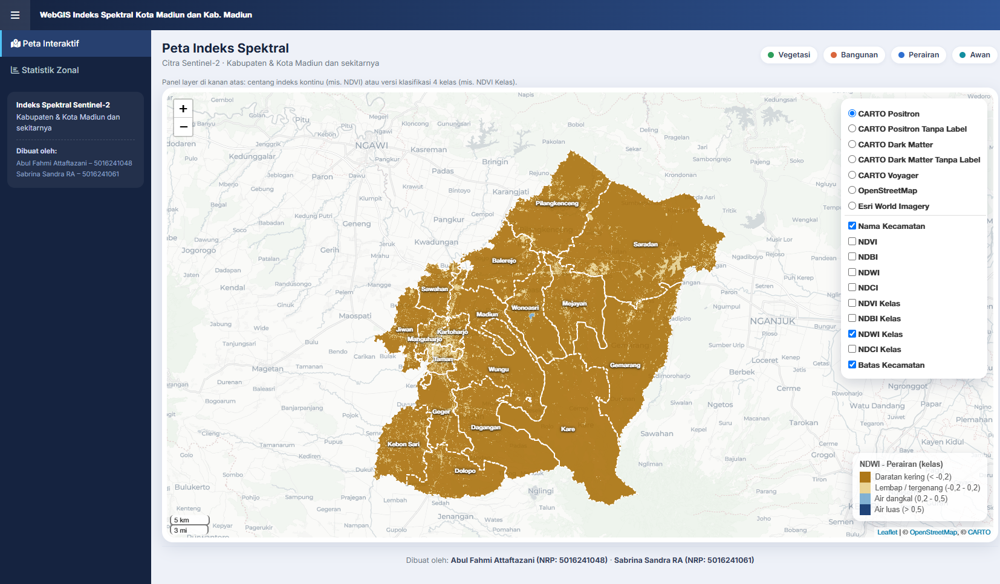 | 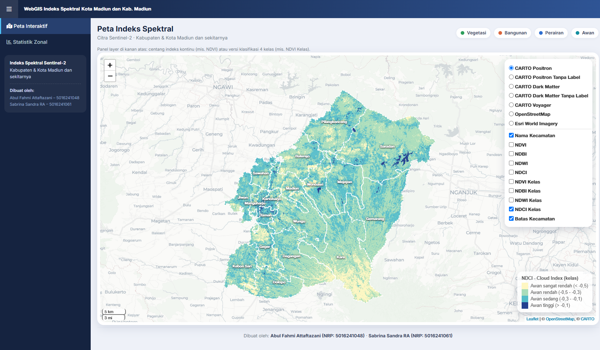 |

Popup nilai per kecamatan, tab **Statistik Zonal**, jendela **Tentang**, serta
tampilan pada perangkat bergerak:

| Popup kecamatan | Tab Statistik Zonal |
|:---:|:---:|
| 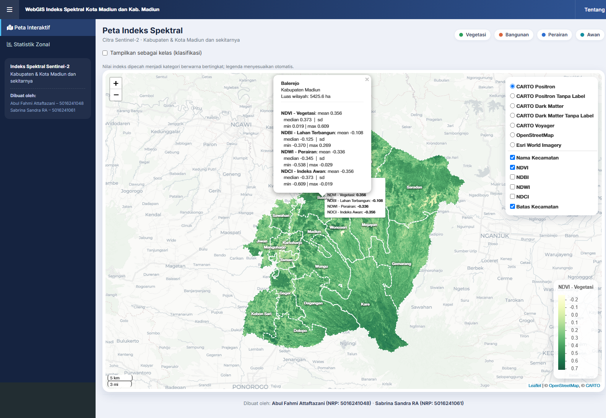 | 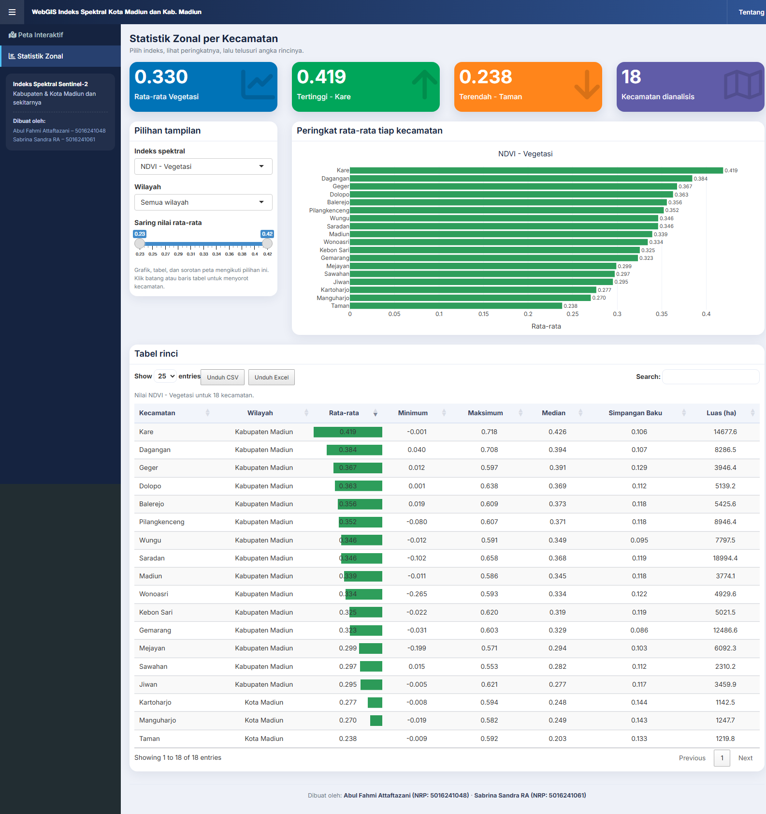 |

| Jendela Tentang | Tampilan ponsel |
|:---:|:---:|
| 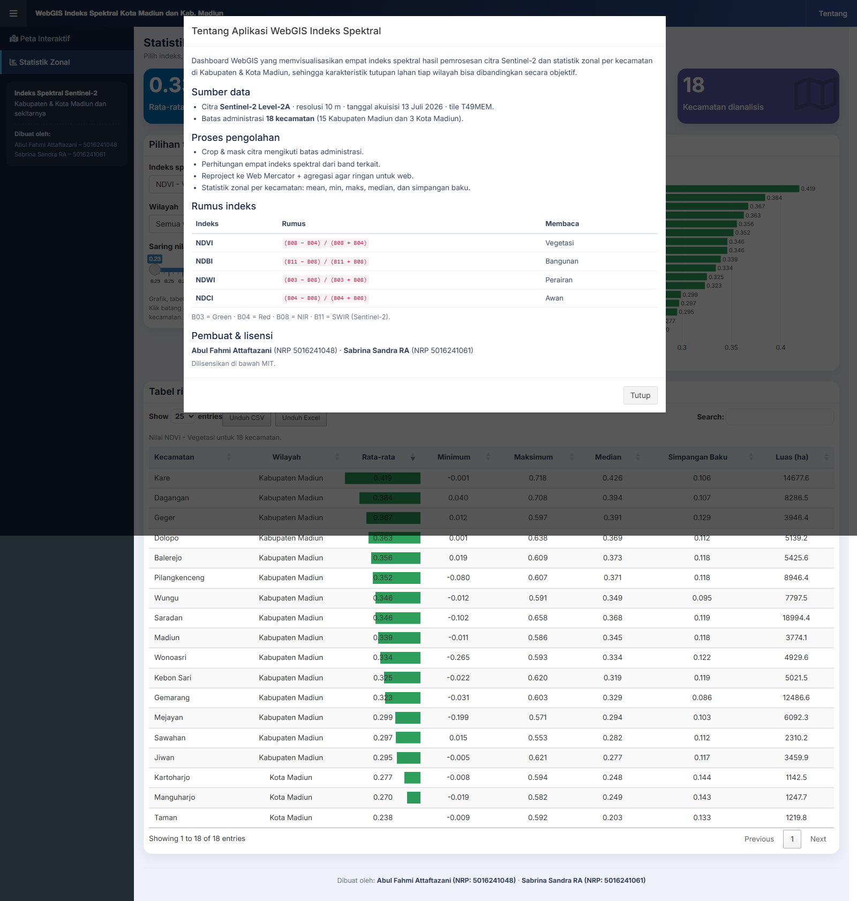 | 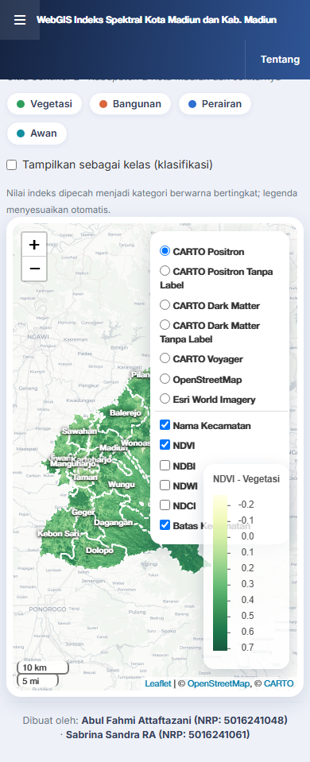 |

## Fitur

- **Peta interaktif berbasis Leaflet** dengan enam pilihan basemap: empat varian
  CARTO (Positron & Dark Matter, dengan/tanpa label), OpenStreetMap, dan citra
  satelit Esri World Imagery.
- **Empat indeks spektral** yang dapat dinyalakan satu per satu (NDVI, NDBI,
  NDWI, NDCI) dengan palet warna berbeda.
- **Mode klasifikasi 4 kelas** untuk setiap indeks (`NDVI Kelas`, `NDBI Kelas`,
  `NDWI Kelas`, `NDCI Kelas`) dengan legenda kategori. Mode kontinu dan kelas
  pada indeks yang sama saling eksklusif, sehingga peta tidak pernah bertumpuk.
- **Overlay batas & nama kecamatan** yang dapat dinyalakan/dimatikan secara
  mandiri tanpa mengganggu indeks.
- **Popup nilai per kecamatan** dan **sorotan wilayah** langsung dari peta.
- **Statistik zonal interaktif**:
  - Filter **wilayah**: Kota Madiun, Kabupaten Madiun, atau semua wilayah.
  - Grafik peringkat kecamatan (hover & zoom) berbasis Plotly.
  - Slider untuk menyaring kecamatan berdasarkan rentang nilai rata-rata.
  - Tabel rinci yang dapat diurutkan, dicari, dan dipaginasi (DT).
- **Sinkronisasi peta dan tabel**: klik batang grafik atau baris tabel untuk
  menyorot kecamatan terkait di peta, dan sebaliknya.

## Indeks Spektral

| Indeks | Nama Lengkap | Rumus | Deskripsi |
|:------:|--------------|-------|-----------|
| **NDVI** | Normalized Difference Vegetation Index | `(B08 − B04) / (B08 + B04)` | Mengukur kerapatan dan kesehatan vegetasi; nilai tinggi menandakan tutupan hijau rapat. |
| **NDBI** | Normalized Difference Built-up Index | `(B11 − B08) / (B11 + B08)` | Menandai lahan terbangun seperti permukiman, kawasan industri, dan jalan. |
| **NDWI** | Normalized Difference Water Index | `(B03 − B08) / (B03 + B08)` | Menandai keberadaan badan air: sungai, waduk, kolam, hingga sawah tergenang. |
| **NDCI** | Normalized Difference Cloud Index | `(B04 − B08) / (B04 + B08)` | Menandai keberadaan awan pada citra sehingga tutupan awan dapat dipisahkan dari daratan dan perairan. |

> B03 = Green, B04 = Red, B08 = NIR, B11 = SWIR (Sentinel-2 Level-2A, 10 m).

## Keterangan

| Kategori | Alat |
|----------|------|
| Bahasa & lingkungan | R 4.6.1, RStudio |
| Framework web | Shiny, shinydashboard |
| Peta interaktif | Leaflet, leaflet.extras |
| Data vektor | sf |
| Data raster | terra, raster |
| Tabel & grafik | DT, ggplot2, plotly |
| Manipulasi data | dplyr |
| Geospasial backend | GDAL, PROJ, GEOS |
| Sumber citra | Sentinel-2 Level-2A (resolusi 10 m) |

## Struktur Proyek

```
.
├─ app.R          # Aplikasi dashboard Shiny (WebGIS)
├─ tubes.R        # Praproses: hitung indeks + statistik zonal dari citra
├─ utils.R        # Fungsi bantu murni (dipakai app.R & diuji di tests/)
├─ tests/         # Pengujian unit testthat
├─ docs/          # Tangkapan layar lengkap (12 gambar) untuk dokumentasi
├─ scripts/       # Script bantu (deployment shinyapps.io)
├─ README.md      # Dokumentasi proyek
├─ CHANGELOG.md   # Riwayat perubahan
├─ LICENSE        # Lisensi MIT
├─ CITATION.cff   # Metadata sitasi
├─ Data/          # (tidak di-commit) data masukan: batas administrasi + citra
└─ output/        # (sebagian besar tidak di-commit) raster indeks + CSV statistik
```

## Memulai

### 1. Prasyarat

- R (**R 4.6.1** atau lebih baru)
- Paket R berikut:

```r
install.packages(c(
  "shiny", "shinydashboard", "leaflet", "sf", "raster",
  "terra", "DT", "ggplot2", "plotly", "leaflet.extras", "dplyr"
))
```

### 2. Menyiapkan data

1. Letakkan **batas administrasi** di folder `Data/` (nama berkas berpola
   `batas`).
2. Siapkan **citra Sentinel-2 Level-2A**.
3. Jalankan `tubes.R` untuk menghasilkan raster indeks dan tabel statistik ke
   folder `output/`:

   - `NDVI_madiun.tif`, `NDBI_madiun.tif`, `NDWI_madiun.tif`,
     `NDCI_Cloud_Madiun.tif`
   - `Zonal_Statistics_Madiun.csv`

### 3. Menjalankan dashboard

Dari akar proyek (tempat `app.R` berada):

```r
shiny::runApp()
```

atau melalui command line:

```bash
Rscript app.R
```

> `app.R` menggunakan path relatif (`Data/` dan `output/`). Pastikan folder
> tersebut tersedia di akar proyek sebelum menjalankan.

### 4. Menjalankan pengujian

Pengujian unit memastikan fungsi bantu (pencarian berkas & pencocokan nama
kecamatan) berfungsi sebelum aplikasi dijalankan:

```bash
Rscript tests/testthat.R
```

## Sumber Data

- **Citra**: Sentinel-2 Level-2A
  (`S2A_MSIL2A_..._T49MEM_...`), resolusi spasial 10 m.
- **Batas administrasi**: batas kecamatan Kabupaten & Kota Madiun.

## Keluaran

`output/Zonal_Statistics_Madiun.csv` berisi satu baris per kecamatan (18
kecamatan: 15 di Kabupaten Madiun dan 3 di Kota Madiun) dengan kolom statistik
untuk setiap indeks:

| Kolom | Keterangan |
|-------|------------|
| `Kecamatan` | Nama kecamatan |
| `*_Mean` | Nilai rata-rata indeks |
| `*_Minimum` | Nilai minimum |
| `*_Maximum` | Nilai maksimum |
| `*_Median` | Nilai median |
| `*_SD` | Simpangan baku (standar deviasi) |

## Catatan

- Berkas citra dan raster berukuran besar **tidak** disertakan dalam repositori
  (lihat `.gitignore`). Hanya tabel statistik ringkas yang disertakan.
- `tubes.R` masih menggunakan path absolut pada `setwd()` dan `folder_citra`;
  sesuaikan dengan lokasi data Anda sebelum menjalankannya.

## Penulis

| Nama | NRP |
|------|-----|
| Abul Fahmi Attaftazani | 5016241048 |
| Sabrina Sandra RA | 5016241061 |

## Lisensi

Dirilis di bawah lisensi [MIT](LICENSE).
